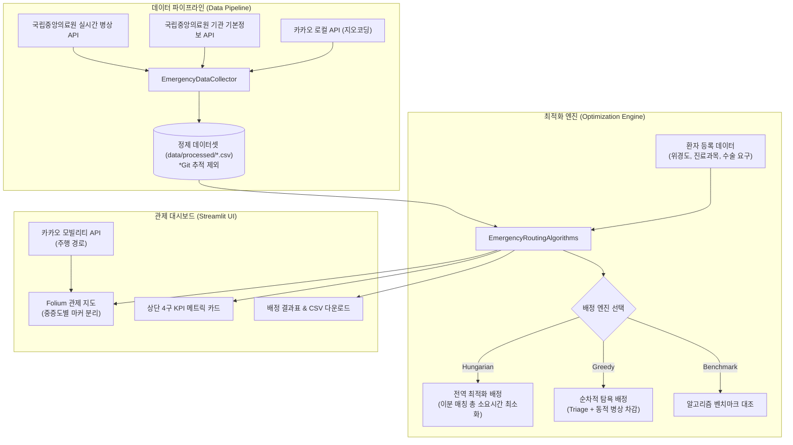

# Golden Time

> **실시간 응급환자 이송 관제 및 병원 최적 배정 시스템**  
> Real-Time Emergency Patient Dispatch & Hospital Routing Optimization System

[](https://www.python.org/)
[](https://streamlit.io/)
[](https://python-visualization.github.io/folium/)
[](https://networkx.org/)
[](https://scipy.org/)
[](https://github.com/your-username/GoldenTime/actions)

---

## 1. 개요

응급의료 현장에서 환자의 생존율은 **골든타임(Golden Time)** 내에 적합한 응급실에 도착하는지에 따라 결정됩니다. 그러나 실제 현장에서는 특정 병원으로의 이송 편중, 가용 병상 부족, 필수 진료과목 부재 등으로 인한 **응급실 수용 거부(이른바 '응급실 뺑뺑이')** 문제가 지속되고 있습니다.

**Golden Time**은 보건복지부 산하 국립중앙의료원의 공공데이터 API(실시간 가용 병상, 24개 진료과목, 11대 중증 응급수술 가능 여부)와 카카오 모빌리티 API를 연동하여, 환자의 중증도와 진료 요구조건에 맞는 최적의 병원을 실시간으로 산출하고 이송 경로를 안내하는 관제 대시보드 시스템입니다.

---

## 2. 핵심 기능

- **공공 응급의료 API 실시간 동기화 및 2중 좌표 안전망**
  - 국립중앙의료원 응급의료기관 정보 조회 서비스를 통해 시/도 단위 실시간 가용 병상(`hvec`), 진료과목 코드, 중증 응급수술(뇌출혈, 심근경색 등 11개 항목) 수용 가능 여부를 수집합니다.
  - **좌표 안전망(Fallback)**: 카카오 키워드 지오코딩을 1차로 시도하며, 카카오 키가 없거나 호출 제한 시 공공데이터 기본정보 자체 위경도(`wgs84Lat`, `wgs84Lon`)로 자동 전환되어 키 부재 시에도 데이터 수집이 보장됩니다.
  - **오프라인 데모 시드**: API 키가 없는 환경에서도 즉시 데모가 가능한 서울 주요 상급종합병원 시드 데이터셋 생성기 내장.
- **이중 최적화 배정 엔진 (Dual Optimization Engine)**
  - **전역 최적화 배정 (Global Optimal Matching - Hungarian Algorithm)**: 각 병원의 가용 병상을 개별 슬롯으로 모델링하고 `scipy.optimize.linear_sum_assignment`를 적용하여 전체 환자의 총 이동 시간(Total Dispatch Time)을 수학적으로 전역 최소화합니다.
  - **순차적 탐욕 배정 (Sequential Greedy with Triage)**: 중증도 우선순위(응급수술 > 진료과목) 순으로 배정하며, 배정 즉시 병상 수를 1 차감하고 그래프 엣지 가중치를 동적 재계산하여 병목 현상을 방지합니다.
  - **알고리즘 벤치마크 모드**: 동일한 환자 발생 상황에서 탐욕법 대비 전역 최적화의 총 소요시간 단축폭(분) 및 개선율(%)을 실시간 대조 평가합니다.
- **관제 센터 핵심 성과 지표 (KPI Dashboard) & 일지 내보내기**
  - 결과 화면 상단에 **평균 이송 시간**, **골든타임 준수율 (30분 이내 도착 비율)**, **최대 이송 시간**, **배정 완료율** 4구 메트릭 카드를 실시간 렌더링합니다.
  - 관제 결과를 공식 이송 일지(Dispatch Log) 형식의 UTF-8 CSV 파일로 즉시 다운로드할 수 있는 내보내기 기능을 제공합니다.
- **GIS 관제 지도 및 중증도별 마커 시각화**
  - Folium 지도상에 가용 병상 상태별 병원 마커(녹색/주황/적색), 응급수술 환자(적색 긴급 마커), 일반진료 환자(청색 마커)를 구분 표시합니다.
  - 카카오 모빌리티 실시간 주행 경로를 매핑하며, 키 부재 시 직선 경로로 즉시 Fallback 됩니다.

---

## 3. 사용 데이터 및 스키마 명세

본 프로젝트는 공공데이터포털(data.go.kr)의 공공 API와 Kakao Developers API를 결합하여 데이터를 수집·정제합니다.

### 3.1. 외부 데이터 소스

| 구분 | 제공처 | 서비스 / API 명칭 | 주요 활용 데이터 |
| :--- | :--- | :--- | :--- |
| **실시간 병상** | 보건복지부 / 국립중앙의료원 | 전국 응급의료기관 실시간 가용병상 정보 조회 (`getEmrrmRltmUsefulSckbdInfoInqire`) | 기관코드(`hpid`), 응급실 실시간 가용병상 수(`hvec`), 응급실 연락처 |
| **의료기관 상세** | 보건복지부 / 국립중앙의료원 | 응급의료기관 기본정보 조회 (`getEgytBassInfoInqire`) | 개설 진료과목 목록(`dgidIdName`), 11종 응급수술 가능 여부(`MKioskTy1~11`), 자체 WGS84 좌표 |
| **좌표 변환 (GIS)** | Kakao Developers | 로컬 키워드 장소 검색 API | 병원명 기반 지오코딩 위도(`latitude`, y), 경도(`longitude`, x) |
| **모빌리티 경로** | Kakao Developers | 카카오모빌리티 길찾기 (Directions) API | 환자 발생 지점과 병원 간 실제 도로망 주행 선형 좌표 (Polyline Vertexes) |

### 3.2. 11대 중증 응급수술/시술 항목 (`MKioskTy1 ~ 11`)

1. `MKioskTy1`: 뇌출혈수술
2. `MKioskTy2`: 뇌경색의재관류
3. `MKioskTy3`: 심근경색의재관류
4. `MKioskTy4`: 복부손상의수술
5. `MKioskTy5`: 사지접합의수술
6. `MKioskTy6`: 응급내시경
7. `MKioskTy7`: 응급투석
8. `MKioskTy8`: 조산산모
9. `MKioskTy9`: 정신질환자
10. `MKioskTy10`: 신생아
11. `MKioskTy11`: 중증화상

### 3.3. 수집·정제 데이터셋 스키마 (`data/processed/hospitals_{시·도}.csv`)

| 컬럼명 | 데이터 타입 | 설명 및 비고 |
| :--- | :--- | :--- |
| `hospital_id` | String | 의료기관 고유 식별 코드 (국립중앙의료원 `hpid`) |
| `name` | String | 의료기관 공식 명칭 (예: 서울대학교병원) |
| `phone` | String | 응급실 직통 전화번호 |
| `available_beds` | Integer | 실시간 응급실 잔여 병상 수 (음수 및 결측치는 0으로 정제) |
| `dgidIdName` | String | 개설 진료과목 목록 (쉼표 구분) |
| `MKioskTy1` ~ `11` | String ('Y' / 'N') | 각 중증 응급수술/시술 수용 가능 여부 플래그 |
| `latitude` | Float | 위도 (카카오 지오코딩 우선 / 공공 WGS84 Fallback) |
| `longitude` | Float | 경도 (카카오 지오코딩 우선 / 공공 WGS84 Fallback) |

> ⚠️ **저장소 데이터 관리 정책**:  
> 실시간성 데이터의 특성 및 저장소 경량화를 위해 **생성된 CSV 데이터셋 파일은 GitHub 저장소에 커밋되지 않습니다** (`.gitignore` 적용). 최초 실행 시 사이드바의 **`해당 지역 데이터 수집 및 갱신`** 버튼을 클릭하여 최신 실시간 데이터를 직접 동기화하여 사용할 수 있습니다.

---

## 4. 시스템 아키텍처 



---

## 5. 배정 알고리즘 및 수학적 모델 

### 5.1. 구면 거리 및 소요시간 산출 

환자 위치 $P(\phi_1, \lambda_1)$와 병원 위치 $H(\phi_2, \lambda_2)$ 간의 구면 거리는 하버사인(Haversine) 공식을 통해 계산합니다:

$$d(P, H) = 2R \arcsin\left(\sqrt{\sin^2\left(\frac{\Delta \phi}{2}\right) + \cos(\phi_1)\cos(\phi_2)\sin^2\left(\frac{\Delta \lambda}{2}\right)}\right)$$

- $R = 6,371\text{ km}$ (지구 평균 반경)
- 도심지 응급차량 평균 주행 속도($v_{\text{avg}} = 40\text{ km/h}$) 기준 예상 주행 시간 $T_{\text{est}}$(분):

$$T_{\text{est}} = \frac{d(P, H)}{v_{\text{avg}}} \times 60$$

### 5.2. 목적 비용 함수 

환자 $P_i$가 병원 $H_j$로 이송될 때의 비용 $C(P_i, H_j)$는 이동 시간과 가용 병상 $B_j$의 역수 페널티의 합으로 정의됩니다:

$$C(P_i, H_j) = T_{\text{est}}(P_i, H_j) + \text{Penalty}(B_j)$$

$$\text{Penalty}(B_j) = \begin{cases} \dfrac{\alpha}{B_j} & (B_j > 0) \\ \infty & (B_j \le 0) \end{cases}$$

- $\alpha = 5.0$ (병상 가중치 계수): 가용 병상이 적을수록 가중치가 급증하여 다른 여유 병원으로 분산을 유도합니다.
- 가용 병상이 0개 이하인 경우 페널티 상수($99,999$)를 부여하여 비응급 배정을 방지합니다.

### 5.3. 헝가리안 알고리즘 기반 전역 최적화

각 병원 $H_j$의 가용 병상 수 $B_j$만큼 병상 슬롯 $S = \{s_{j, 1}, \dots, s_{j, B_j}\}$을 생성하여 환자 집합 $P$와의 이분 매칭 비용 행렬 $W_{N \times M}$을 구축합니다.  
환자-병상 간 매칭 순열 $\sigma$에 대해 전체 환자의 총 이송 비용 합을 전역 최소화합니다:

$$\min_{\sigma} \sum_{i=1}^{N} C\left(P_i, S_{\sigma(i)}\right) \quad \text{subject to } \sigma(i) \neq \sigma(k) \; (\forall i \neq k)$$

`scipy.optimize.linear_sum_assignment`를 통해 $O(N^3)$ 다항 시간에 전역 최적해(Global Optimum)를 도출합니다.

### 5.4. 순차적 탐욕 배정 및 실시간 병상 차감 

중증도(수술 환자 선순위) 순으로 정렬된 환자에게 최단 가중치 병원을 순차 배정하며, 배정 즉시 병원 가용 병상을 차감합니다:

$$B_j \leftarrow \max(0, B_j - 1)$$

갱신된 $B_j$를 바탕으로 대기 중인 후속 환자들의 엣지 가중치를 실시간 재계산합니다.

---

## 6. 프로젝트 구조 

```text
GoldenTime/
├── .github/
│   └── workflows/
│       └── ci.yml          # GitHub Actions CI 파이프라인 (Lint & Pytest 자동화)
├── app.py                  # Streamlit 관제 대시보드 메인 앱
├── requirements.txt        # 운영 환경 의존성 패키지 목록
├── requirements-dev.txt    # 개발 및 테스트 의존성 목록 (pytest, flake8)
├── .env.example            # 환경변수 설정 템플릿
├── .gitignore              # Git 제외 파일 설정 (데이터셋 .csv 및 .env 제외)
├── data/
│   └── processed/          # 수집된 권역별 병원 데이터셋 (.csv 저장 경로)
├── src/
│   ├── __init__.py         # 패키지 선언
│   ├── config.py           # 환경변수 및 전역 설정 관리 (Settings)
│   ├── constants.py        # 권역 좌표, 진료과목, 11대 응급수술 코드 매핑 상수
│   ├── collector.py        # 국립중앙의료원 API 및 카카오 로컬 수집기
│   └── algorithms.py       # 최적 배정 엔진 (Hungarian 전역 최적화 + Greedy 비교)
└── tests/
    ├── __init__.py
    ├── test_algorithms.py  # 배정 알고리즘 핵심 단위 테스트 (12개 테스트 케이스)
    └── test_config.py      # 환경 설정 모듈 검증 테스트
```

---

## 7. 설치 및 실행 가이드

### 7.1. 가상환경 생성 및 패키지 설치

```bash
# 저장소 복제
git clone https://github.com/your-username/GoldenTime.git
cd GoldenTime

# 가상환경 생성 (권장: Python 3.10 이상)
python3 -m venv venv
source venv/bin/activate  # Windows: venv\Scripts\activate

# 기본 패키지 설치
pip install -r requirements.txt

# (선택) 테스트 및 개발 도구 설치
pip install -r requirements-dev.txt
```

### 7.2. 단위 테스트 및 린트 검사

```bash
# pytest 단위 테스트 실행 (14개 케이스 전체 검증)
pytest tests/ -v

# flake8 정적 코드 품질 검사
flake8 src/ tests/ --max-line-length=127
```

### 7.3. 환경 변수 설정 (`.env`)

프로젝트 루트의 `.env.example`을 복사하여 `.env` 파일을 생성하고 발급받은 API 키를 입력합니다:

```bash
cp .env.example .env
```

```env
# 공공데이터포털 국립중앙의료원 전국 응급의료기관 정보 조회 인증키
PUBLIC_DATA_KEY=your_public_data_api_key_here

# Kakao Developers REST API 키
KAKAO_API_KEY=your_kakao_rest_api_key_here
```

### 7.4. 대시보드 실행

```bash
streamlit run app.py
```

브라우저에서 `http://localhost:8501`로 접속하여 관제 시스템을 이용할 수 있습니다.

---

## 8. 사용 방법

1. **지역 및 알고리즘 엔진 선택**:
   - 좌측 사이드바에서 관제 대상 지역을 선택합니다.
   - **배정 알고리즘 엔진**(`전역 최적화 (Hungarian)`, `순차적 탐욕법 (Greedy)`, `알고리즘 벤치마크 비교`)을 선택합니다.
   - 처음 실행하거나 최신 현황으로 갱신하려면 **`해당 지역 데이터 수집 및 갱신`** 버튼을 클릭합니다.
2. **환자 요구조건 설정**:
   - `응급수술 (긴급)` 또는 `진료과목 (일반)`을 선택하고 세부 조건을 지정합니다.
3. **환자 발생 등록**:
   - `무작위 생성` 슬라이더를 조절하거나 `지도 직접 선택`을 통해 관제 지도에서 위치를 클릭하여 환자를 등록합니다.
4. **최적 경로 배정 실행 및 관제 모니터링**:
   - **`최적 경로 배정 실행`** 버튼을 클릭합니다.
   - 상단 **4구 KPI 메트릭 카드**(평균 이송 시간, 골든타임 준수율, 최대 이송 시간, 배정 완료율)를 확인합니다.
   - **`이송 관제 일지 CSV 다운로드`** 버튼을 눌러 배정 결과 보고서를 내려받을 수 있습니다.

---

## 9. API 키 발급처 안내 

- [공공데이터포털 (data.go.kr)](https://www.data.go.kr/data/15000563/openapi.do): 국립중앙의료원 전국 응급의료기관 정보 조회 서비스
- [Kakao Developers (developers.kakao.com)](https://developers.kakao.com/): 로컬(키워드 장소 검색) API 및 모빌리티 길찾기 API

---

## 10. 향후 개선 과제 및 로드맵

본 시스템을 실제 대규모 응급의료 관제 현장 수준으로 고도화하기 위한 핵심 로드맵입니다:

### 10.1. 데이터 아키텍처: 정적 마스터 데이터와 실시간 병상의 계층적 분리 
- **현안**: 현재 시/도별로 정적 정보(위경도, 진료과목)와 동적 정보(실시간 병상)를 매번 합쳐서 수집하므로, 미수집 권역에서는 데이터가 부재하고 수집 지연이 발생합니다.
- **개선안**:
  - 전국 400여 개 응급의료기관의 위치 및 시설 정보를 단일 마스터 데이터셋(`data/hospitals_master.csv`)으로 사전 구축
  - 대시보드 구동 시 선택된 지역의 실시간 병상 수(`hvec`) API만 On-Demand로 가볍게 결합하여, **전국 17개 시·도 전역을 즉시 지원**

### 10.2. TTL 기반 스마트 자동 캐싱 
- 수동 버튼 클릭 방식에서 탈피하여 `@st.cache_data(ttl=300)` 기반 5분 주기 자동 백그라운드 갱신 도입
- 공공데이터 API 장애 또는 호출 한도 초과 시 직전 성공 스냅샷(Last Known Good) 자동 유지

### 10.3. 디지털 트윈 실시간 병상 변동 시뮬레이터 
- API 호출 한도 및 심야 시간대 병상 정체 문제를 보완하기 위해, 가상 환자 입원/퇴원 이벤트에 따라 실시간으로 병상이 동적 변동하는 시뮬레이터 모드 탑재

### 10.4. 질환별 골든타임 임계치 경고 시스템
- 질환별 맞춤 골든타임 임계치(뇌졸중/심근경색 60분, 중증외상 60분 등)를 초과할 위험이 있는 배정에 대해 테이블 경고 뱃지 부여 및 관제 지도상 긴급 마커 강조